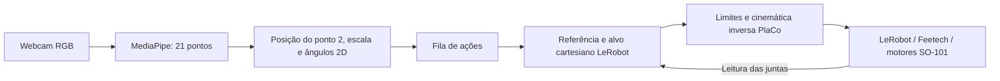
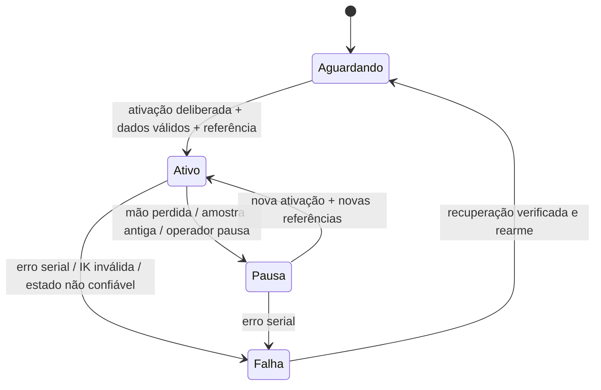
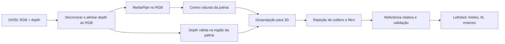

# Pesquisa: tracking da mão e teleoperação do SO-101

Data: 18 de novembro de 2026. Escopo: pesquisa e análise estática; nenhuma alteração ao controlo ou ensaio físico foi feita para este documento. A câmara informada pelo operador é uma **RealSense D435i**. As propostas abaixo ainda precisam de medição e validação no hardware concreto.

## 1. Resumo para decisão

O problema atual não se resume à escolha do detetor. Há riscos concretos no modo como imagens, referências, ações e motores são ligados. Recomenda-se primeiro **parar o envio de comandos antigos, criar ativação e rearmamento explícitos, e limitar a velocidade e a continuidade das juntas**. Em paralelo, vale experimentar a D435i para medir profundidade, mantendo inicialmente o MediaPipe. Só depois faz sentido comparar um modelo YOLO de 21 pontos em gravações iguais e com métricas iguais.

Não existe demonstração de que o sistema atual tenha segurança funcional. O último teste supervisionado documentado produziu movimento visível, mas terminou com timeout de leitura do motor 1. A presença de um limite no código não prova que o braço não pode colidir nem que reage corretamente a uma falha de comunicação.

## 2. Visão geral e nomes

**Tracking** é acompanhar estimativas ao longo do tempo; **landmark** é um ponto estimado da mão; **FK** é cinemática direta, que estima a pose da garra a partir dos ângulos; **IK** é cinemática inversa, que procura ângulos para uma pose desejada; **retargeting** é adaptar movimento humano às capacidades de outro corpo. Um alvo geométrico alcançável não garante ausência de colisão nem precisão física.

Figura oficial com os 21 pontos usados pelo MediaPipe, incluindo 0 = pulso, 2 = base do polegar, 4 = ponta do polegar, 5 = base do indicador, 8 = ponta do indicador, 9 = base do médio, 12 = ponta do médio e 17 = base do mindinho:

Fonte e explicação: [Google, Hand Landmarker](https://developers.google.com/edge/mediapipe/solutions/vision/hand_landmarker). O MediaPipe usa modelos treinados de deteção da palma e estimação dos pontos; não é apenas geometria. Em modo vídeo, reaproveita a região da mão entre imagens e volta a detetar quando necessário. As coordenadas `x,y` são normalizadas pela largura e altura, e `world_landmarks` são estimativas em metros **centradas na mão**, não uma medição absoluta da distância à câmara.

## 3. O que o nosso código faz, exatamente

Fontes locais: [`hand_camera_teleop.py`](../Brosnantest/hand_camera_teleop.py) e [`camera_processor.py`](../Brosnantest/camera_processor.py). O segundo declara o esquema dos campos e passa os valores adiante; a matemática principal está no primeiro e nos processadores LeRobot.

| Fase | Implementação atual | Consequência para o operador |
|---|---|---|
| Arranque | Câmara `/dev/video0`, pedido de 640×480 a 30 FPS, MediaPipe `VIDEO`, uma mão, limiares 0,5; robô ligado em seguida; linhas 40–115. | A taxa real depende da câmara e do tempo de processamento. O pedido de FPS não é medição. |
| Armamento | `enabled=True` desde a primeira iteração do robô, sem gesto de confirmação; linhas 284–296. A referência do braço é estabelecida no loop; a da mão aparece na primeira deteção. | Não existe uma posição inicial sincronizada nem uma pose oficial para começar. Qualquer mão detetada pode influenciar o robô. |
| Posição | Usa o ponto **2**, não o centro da palma. Filtragem exponencial `0,9 valor anterior + 0,1 amostra` e subtração da primeira posição; linhas 240–247, 269–273. | O movimento e a rotação do polegar alteram a referência de translação; um só ponto pode oscilar. |
| Profundidade | `depth_estimate` soma comprimentos 2D de segmentos do polegar e indicador; linhas 165–175, 231–238. | Abrir, fechar ou rodar a mão pode parecer aproximação ou afastamento. Não é profundidade medida. |
| Garra | Ângulo 2D entre vetores de 0→4 e 0→8; manda a **diferença** face ao ângulo anterior como `gripper_vel`; linhas 249–258, 269–278. | É sensível à projeção e não é a medição 4–9–12 discutida antes. Uma ação antiga de velocidade pode ser repetida. |
| Orientação | Ângulo 2D entre direção inicial e atual do polegar, com sinal decidido pela componente vertical; linhas 154–163, 260–267. | Não é uma normal 3D da palma; pode ser descontínuo perto da mudança de sinal ou de vetor muito pequeno. |
| Troca de eixos | `target_x=Δx imagem`, `target_z=-Δy imagem`, `target_y=-Δescala`; gripper ×0,5 e ângulo ×0,01745; linhas 303–310. | A sensação depende da orientação da câmara, espelhamento e montagem. Um eixo da imagem não é automaticamente um eixo físico do robô. |
| IK | Referência LeRobot com fator 0,5 por eixo; caixa cartesiana ±1 m, `max_ee_step_m=0,10`, IK iniciada a partir da leitura atual; linhas 57–78. | A caixa é genérica e não representa a mesa, a área livre ou o alcance real; 10 cm é o valor por chamada configurado, não uma velocidade segura medida. |

**Detalhe geométrico:** `x` é dividido pela largura e `y` pela altura. Como a imagem é 640×480, calcular ângulos e comprimentos diretamente com esses valores distorce a geometria relativamente aos píxeis: para distâncias 2D coerentes deve-se converter para píxeis ou corrigir a razão de aspeto. Mesmo assim, um ângulo 2D continua dependente da perspetiva.

### 3.1 Filas, perda de mão e falhas

- A fila de frames tem capacidade 5 e rejeita o frame novo quando cheia, guardando os antigos; a fila de ações tem capacidade 100 e também rejeita novos quando cheia. O consumidor retira uma ação de cada vez. As filas podem introduzir atraso e executar movimentos velhos; a quantidade efetiva de atraso não foi medida aqui. Ver linhas 119–130, 269–277, 303–316.
- Quando não há mão, não se coloca uma ação nova de parada. O ciclo do braço conserva e volta a enviar `camera_action`, incluindo o último `gripper_vel`. Logo **mão perdida não equivale a HOLD**. Na [fonte LeRobot v0.7.0](https://github.com/huggingface/lerobot/blob/v0.7.0/src/lerobot/robots/so_follower/robot_kinematic_processor.py), `GripperVelocityToJoint` acrescenta `gripper_vel × speed_factor` à posição lida e limita o alvo; portanto repetir um valor não nulo pode continuar a deslocar o alvo da garra. O efeito físico depende da leitura e da resposta do motor e não foi medido nesta pesquisa.
- O ciclo transmite continuamente e não há timeout de idade da amostra de visão, confirmação de presença, rearme nem tratamento explícito de erros entre threads no código local. Uma exceção numa thread pode deixar as outras sem encerramento coordenado. A política de motor/torque após falha ou desligamento tem de ser estabelecida e validada com o braço; congelar objetivo não é o mesmo que corte físico.
- `angle_between_vectors` divide pela norma sem verificar vetor de comprimento zero; NaN ou ângulos instáveis são uma possibilidade geométrica, não uma ocorrência observada.

Estas características explicam **hipóteses plausíveis** para a cobra tonta, tremores e saltos. Sem registos sincronizados de entrada, alvo IK, posições e erros, não se pode atribuir cada episódio a uma causa única. Não alterar calibração, limites de URDF ou ganhos como diagnóstico por tentativa e erro.

## 4. Como eu começaria a operação

O comportamento atual não define uma pose de início segura. Proposta, ainda não implementada:

1. Apoiar o braço numa pose confortável já dentro do espaço livre; manter os cabos soltos. Escolher uma pose de mão confortável com a palma claramente visível, sem depender de 100% de confiança e sem uma contagem desconhecida.
2. O sistema mostra **À ESPERA**. Não aplica movimentos enquanto a pessoa posiciona a mão. Um comando deliberado de ativação — tecla ou gesto acordado depois — pede a ativação; não presumir que qualquer deteção é consentimento.
3. Depois de uma curta janela configurável de estabilidade, guardar **ao mesmo tempo lógico** a posição/orientação da mão e a pose da garra calculada a partir de leituras recentes dos motores. Mostrar **ATIVO**. A primeira amostra tem deslocamento zero; o início não deve saltar.
4. Deslocamentos relativos da mão geram alvos relativos à pose capturada. A orientação fixa da câmara e a convenção de eixos são definidas uma vez e verificadas por movimentos isolados, não assumidas. Espelhar a pré-visualização é uma escolha visual; o mapeamento tem de ser consistente com o que a pessoa vê e com a direção física desejada.
5. Perda de mão, frame antigo, profundidade inválida persistente ou gesto de desativação: rejeitar dados e entrar em **PAUSA**, sem continuar uma velocidade anterior. Na recuperação, exigir ativação explícita e recapturar as duas referências; não saltar para a pose antiga. Se a leitura ou escrita dos motores falhar, sinalizar falha e executar encerramento apropriado; não prometer que enviar HOLD será possível com a serial interrompida.

## 5. Qual ponto e qual matemática?

### 5.1 Translação

**Um ponto só** é fácil de compreender e pode funcionar, mas o ponto 2 pertence à base do polegar, que se move com a garra. **Média de todos os 21 pontos** também não é ideal para translação: ao fechar os dedos, a média desloca-se mesmo que a palma esteja imóvel. Sugestão inicial de pesquisa: centro de pontos mais rígidos da palma, por exemplo média de 0, 5, 9, 13 e 17, comparada experimentalmente com 9 isolado e com o ponto 2. O melhor depende de oclusão e da pose; não é garantido que a média ganhe.

Com RGB sem depth: usar Δu e Δv em píxeis corrigidos por aspeto, e tratar variação de escala apenas como **comando relativo heurístico**, não como distância de verdade. A escala confunde rotação, articulação e aproximação. Se não houver Z confiável, pode ser preferível desativar Z ou usar um controlo separado do que movimentar involuntariamente.

Com RGB-D: obter um ponto 3D da palma `pC(t)` no referencial da câmara, guardar `pC0` na ativação e aplicar `pR_alvo = pR0 + S R (pC(t) − pC0)`. `R` é a transformação de eixos escolhida entre a câmara e a base do robô; `S` contém ganhos ajustáveis. A câmara **não precisa de ver o robô**, mas é necessário definir a correspondência de direções. Se mudar a orientação física da câmara, rever essa correspondência. A relação 1:1 em metros é possível em princípio, mas não garante que a garra alcance todos os alvos nem que o mundo virtual coincida exatamente com o braço.

Os anteriores “20 cm de mão para cada lado” são um desejo de escala de entrada, não limites da garra. Perto das fronteiras, uma caixa por eixo não caracteriza todo o espaço alcançável: singularidades, limites de juntas e colisões tornam o alcance dependente da posição e orientação. Evitar extrapolar que cada direção tem um único máximo constante.

### 5.2 Garra e orientação

- A abertura pode usar a distância 4–8 ou 4–12, normalizada por uma largura relativamente estável, como 5–17; mapear limites de mão abertos/fechados para a faixa calibrada da garra. Isto é diferente de força: posição ou limitação de corrente não medem força de contacto sem sensores/modelo adequados.
- O ângulo em 9 de 4–9–12, `acos(clamp(((p4−p9)·(p12−p9))/(||p4−p9|| ||p12−p9||),−1,1))`, é uma alternativa. A reta 4–12 é o lado oposto ao ângulo, **só é hipotenusa se o triângulo for retângulo**. Preferir 3D quando dados válidos e comparar com distância normalizada; sem garantir superioridade. Os limites de 10°/60° são pontos de partida a medir, não verdades universais.
- Para a normal, um plano pode usar três pontos não colineares da palma: `n = normalize((p5−p0) × (p17−p0))`. Fixar a convenção do sinal, rejeitar geometria degenerada e considerar ruído/oclusão. O vetor normal dá duas componentes de orientação; **não define rotação completa** em torno de si. O SO-101 tem cinco juntas de braço e uma de garra, portanto não se deve prometer seguir arbitrariamente todas as seis componentes de pose.
- Fazer primeiro translação estável e gripper separadamente. Só depois investigar orientação com menor peso na IK, continuidade e os limites reais do mecanismo.

## 6. D435i: o que acrescenta e o que não acrescenta

A D435i tem profundidade estéreo e uma IMU integrada. A IMU mede movimento da **câmara**, não da mão; com a câmara fixa pode ficar fora do MVP. O [datasheet D400 de 2026](https://www.realsenseai.com/wp-content/uploads/2026/03/RealSense-D400-Series-Datasheet-Mar-2026.pdf) informa profundidade até 1280×720 e até 90 FPS em perfis próprios, RGB até 1920×1080 e intervalo que depende das condições. Estes máximos não significam 90 FPS de RGB+depth+MediaPipe no nosso portátil. O [datasheet de 2022](https://www.realsenseai.com/wp-content/uploads/2022/04/Intel-RealSense-D400-Series-Datasheet-April-2022.pdf) dá Min-Z variável por resolução para D435i, por exemplo ~175 mm a 640×480 e ~280 mm a 1280×720 em condições da tabela; distância mínima detetável não é garantia de qualidade. Começar, como hipótese, com a mão a cerca de 35–60 cm e medir.

Figura ilustrativa do algoritmo estéreo, não é uma captura da nossa câmara. Fonte: [librealsense, Depth from Stereo](https://github.com/realsenseai/librealsense/blob/master/doc/depth-from-stereo.md).

### 6.1 Pipeline candidato

1. Ler frames RGB e depth da mesma sessão; usar timestamps e emparelhamento fornecidos pelo SDK. Alinhar depth ao RGB com `rs.align(rs.stream.color)`. [Exemplo oficial Python](https://github.com/realsenseai/librealsense/blob/master/wrappers/python/examples/align-depth2color.py).
2. Usar RGB para os pontos MediaPipe. Na região interior da palma, calcular uma mediana robusta de píxeis de profundidade válidos, rejeitar zero, fundo e amostras insuficientes. A janela e os critérios devem ser medidos; uma mediana em janela não garante que os píxeis sejam todos da mão. Não preencher buracos e apresentar o resultado como verdade sem validar.
3. Usar intrínsecos associados ao **frame alinhado** e `rs2_deproject_pixel_to_point`; em projeção pinhole ideal: `X=(u−cx)Z/fx`, `Y=(v−cy)Z/fy`, `Z=profundidade`. O SDK lida com modelos de distorção suportados; não presumir que uma fórmula simplificada substitui a calibração do dispositivo. Ver [projeção e referenciais RealSense](https://github.com/realsenseai/librealsense/wiki/Projection-in-RealSense-SDK-2.0).
4. Verificar profundidade válida, carimbo temporal, ruído, fronteiras e correspondência mão/RGB antes de emitir movimento. Temperatura, iluminação, materiais, oclusão e mãos nas bordas podem introduzir buracos, ruído ou mistura com o fundo. O [exemplo oficial de medição](https://github.com/realsenseai/librealsense/blob/master/examples/measure/readme.md) diz que é demonstrativo, não um instrumento de medição de precisão.
5. Comparar custo adicional de captura, alinhamento e visualização, e medir a **idade do frame ao chegar ao comando**. Não assumir que depth torna tudo lento, nem que é grátis. Usar USB apropriado e perfil suportado. O [wrapper oficial Python](https://github.com/realsenseai/librealsense/tree/master/wrappers/python) existe, mas a presença, compatibilidade exata e acesso USB neste container ainda não foram verificados; nenhuma dependência foi instalada.

As intrínsecas e a relação entre sensores RGB/depth são calibrações da própria câmara usadas pelo SDK. Isso não exige um tabuleiro novo para a primeira avaliação, embora precisão real tenha de ser validada com régua e as condições de uso. A transformação entre a câmara do operador e a base do robô é outra coisa; num controlo relativo pode ser uma convenção de eixos e ganhos, mas não surge automaticamente da RealSense.

## 7. Suavidade, limites e comportamento em erro

1. **Usar a amostra mais recente** com carimbo monotónico e substituir frames antigos; limitar também a idade máxima do dado. Evitar fila FIFO que armazena segundos de intenções antigas. Um buffer de tamanho 1 não resolve sozinho frames atrasados dentro do driver.
2. **Detetar e rejeitar observações inválidas**: valores não finitos, mão fora do campo, geometria degenerada, saltos incompatíveis com o movimento e perda de depth. Fazer transição explícita para pausa quando o dado envelhece; não reaproveitar velocidade de garra. Limiar demasiado apertado também pode bloquear movimentos legítimos: medir.
3. **Filtrar com tempo real**: a média exponencial atual reduz tremor, mas a sua resposta depende da frequência; por exemplo, a 30 amostras/s, `α=0,1` tem uma constante de tempo aproximada de 0,32 s em regime ideal. A taxa não é garantida. Comparar EMA com `α(dt)` e [1€ filter](https://direction.bordeaux.inria.fr/~roussel/publications/2012-CHI-one-euro-filter.pdf), que adapta suavização à velocidade; avaliar tremor e atraso em conjunto. Filtro não substitui pausa, limites nem validação de dados.
4. Limitar incrementos no espaço cartesiano **por tempo**, velocidade/aceleração e continuidade dos ângulos de junta; também avaliar proximidade de singularidades e saltos de solução da IK. Uma solução IK deve ser validada com FK e limites calibrados antes do envio. Não remover a calibração LeRobot nem alargar limites do URDF para fazer uma demonstração parecer funcionar.
5. Definir o que fazer quando a IK não resolve, a leitura é velha ou há falha serial: pausa/falha comunicada, não avançar para alvo arbitrário, não rearme automático por simples reaparecimento da mão. Rever o comportamento do LeRobot instalado para determinar se o último comando, torque e desconexão realmente fazem o que pensamos. Um botão de corte físico continua independente de software.
6. Limites cartesianos não evitam colisões com mesa, corpo do operador ou o próprio braço. Não sugerir valores de velocidade, torque ou alcance como seguros sem medições mecânicas e ensaio supervisionado.

## 8. YOLO Hands contra MediaPipe

“YOLO Hands” pode referir-se a detetor de caixa, classificador de gestos ou modelo de pose com **21 pontos**. O nosso problema precisa de coordenadas temporais de pontos; uma caixa ou apenas a classe da mão não substitui os landmarks. A [documentação Ultralytics Hand Keypoints](https://github.com/ultralytics/ultralytics/blob/main/docs/en/datasets/pose/hand-keypoints.md) descreve um dataset com 26.768 imagens e 21 pontos. As próprias anotações foram geradas com MediaPipe: treinar com elas não garante superar os erros do professor e não é ground truth independente. O exemplo mostra treino de YOLO pose sobre o dataset; um checkpoint genérico de corpo não deve ser confundido com pesos já treinados para mãos.

| Critério | MediaPipe atual | YOLO pose especializado para mão |
|---|---|---|
| Disponibilidade aqui | Já instalado e em uso | Peso, versão e compatibilidade ainda a identificar; não instalado nesta pesquisa |
| Pontos | 21, em vídeo, mais estimativas relativas 3D | 21 se o checkpoint tiver sido treinado para esse esquema; confirmar nomes, ordem e visibilidade |
| Temporal | Usa seguimento entre frames no modo vídeo | Confirmar modelo/pipeline: detetar em cada frame não é por si só tracking temporal |
| Desempenho | CPU neste projeto | Pode usar GPU, mas dependências, transferência e inicialização contam; não se conhece a latência no nosso sistema |
| Licença | Ver licença do pacote e modelo | Ultralytics publica código [AGPL-3.0 e opções comerciais](https://www.ultralytics.com/license); dataset documentado CC-BY-NC-SA-4.0. Verificar pesos e dataset concretos antes de distribuir ou usar comercialmente. |

Recomendação: **não trocar já**. Preparar depois uma comparação offline, sem movimento: mesmo vídeo RGB e poses de frente/lado, jacaré, fist, oclusão e luz; mesmo ambiente de execução; reportar p50/p95 do tempo por etapa, perda de pontos, jitter da palma imóvel, saltos e precisão contra amostras anotadas manualmente. Comparar a pipeline completa em CPU e GPU incluindo cópias, sem tratar FPS de marketing como resultado local. O modelo mais rápido numa GPU diferente pode ser mais lento neste container.

## 8.1 Repositórios anteriormente analisados

O quadro distingue os resultados anunciados pelos autores de algo que tenhamos verificado a funcionar no nosso braço. Não se clonou nem instalou nenhum projeto durante esta pesquisa.

| Referência | Abordagem e evidência | O que vale estudar para o nosso caso |
|---|---|---|
| [BrosnanYuen/hand_pose_lerobot_teleop](https://github.com/BrosnanYuen/hand_pose_lerobot_teleop) | RGB, mão e LeRobot; a nossa base local foi adaptada a partir dos dois ficheiros do projeto. O repositório inclui vídeos, mas a demonstração não comprova estabilidade no nosso hardware. | Preservar a simplicidade, MediaPipe e a integração com LeRobot; corrigir a gestão temporal e a ativação documentadas acima. |
| [sruthihsr/SO101-Gesture-Teleoperation](https://github.com/sruthihsr/SO101-Gesture-Teleoperation) | O README descreve webcam, MediaPipe, controlador, TCP, ROS 2 e MuJoCo com IK, e palma para ativação. A demonstração documentada inclui simulação; isso não valida segurança no braço físico. | Considerar a ideia de ativação deliberada e parada explícita; não é necessário restaurar TCP/ROS/MuJoCo apenas para isso. O [repositório ReenaCatherine com nome idêntico](https://github.com/ReenaCatherine/SO101-Gesture-Teleoperation) deve ser comparado por histórico antes de assumir autoria ou equivalência de commits. |
| [ABMI-software/hand_controlLerobot](https://github.com/ABMI-software/hand_controlLerobot) | O README descreve MediaPipe ou WiLoR para pose, Kalman para suavização, LeRobot e YOLOv8 para **objetos**, em projeto mais amplo. O próprio [relatório de inspeção](https://github.com/ABMI-software/hand_controlLerobot/blob/main/CODE_INSPECTION_REPORT.md) distingue o mapeamento direto XYZ→juntas da IK completa no percurso principal. | Estudar buffer da imagem mais recente, filtros e divisão entre sinais; não confundir YOLO de objetos com landmarks de mão. A disponibilidade declarada não é um teste de fiabilidade ou compatibilidade no nosso ambiente. |
| [AFK-Kireeti/Lerobot-SO101](https://github.com/AFK-Kireeti/Lerobot-SO101) | O README apresenta alternativas com MediaPipe/ROS 2, Raspberry Pi/IMU e marcadores ArUco. Os resultados anunciados são intenções do projeto, sem medições independentes conferidas aqui. | O marcador e a IMU são alternativas para orientação, mas adicionam um objeto ou sensor e a respetiva configuração; não são necessários para um primeiro estudo da D435i fixa. |
| [LeRobot](https://github.com/huggingface/lerobot/tree/v0.7.0) e [SO-ARM100](https://github.com/TheRobotStudio/SO-ARM100) | LeRobot é a integração já usada para motores, conversão e processadores; o outro fornece modelo mecânico/URDF. | Reutilizar em vez de escrever outro driver. Confirmar sempre o comportamento da versão **instalada**: o código online `main` pode ser diferente. |

Estes links incluem páginas de projeto que podem mudar; os hashes registados anteriormente estão na [proveniência local](README.md#fontes-e-proveniência). Nenhum limite ou comportamento de segurança é adotado apenas porque aparece no README de outro projeto.

Inspeção adicional do [tracker ABMI](https://github.com/ABMI-software/hand_controlLerobot/blob/main/hand_teleop/tracking/tracker.py): ele começa com `tracking_paused=True`, limita saltos de pose por intervalo de tempo e aplica predição/atualização Kalman quando há medição. A função `predict_pose()` também pode fazer predição sem nova observação: isso merece um timeout próprio se reaproveitarmos a ideia. O valor ali definido para taxa máxima é específico ao projeto e não foi validado para o nosso braço. Estas conclusões são sobre a versão `main` consultada, não sobre o commit histórico previamente registado.

## 9. Trabalhos científicos e prática

| Trabalho primário | Entrada e contribuição | Lições e limite da comparação |
|---|---|---|
| [MediaPipe Hands, 2020](https://arxiv.org/abs/2006.10214) | Deteção de palma e estimativa de landmarks numa sequência RGB. | Mão bem detetada ainda precisa de mapeamento, limites e gestão de falhas. |
| [DexPilot, ICRA 2020](https://arxiv.org/abs/1910.03135) | Visão com câmaras de profundidade e retargeting para braço/mão robóticos. | Demonstra teleoperação em laboratório; câmaras, mão e configuração diferem do nosso SO-101. |
| [Robotic Telekinesis, 2022](https://openreview.net/pdf?id=Z9L-Jde0iPx) | RGB monocular; estima pose humana e usa retargeting treinado para braço/mão robóticos. | Mostra que RGB pode funcionar, mas o artigo reconhece ambiguidade 2D→3D e oclusões. Usa uma arquitetura e robôs diferentes, não é uma prova de precisão métrica do nosso sistema. |
| [AnyTeleop, RSS 2023, UCSD/NVIDIA](https://roboticsproceedings.org/rss19/p015.pdf) | Sistema de pesquisa para vários robôs e câmaras, RGB com ou sem depth; inclui retargeting geométrico e colisões. | Separar perceção, retargeting e controlo é útil; o sistema de investigação é muito maior do que precisamos copiar. |
| [1€ filter, CHI 2012](https://direction.bordeaux.inria.fr/~roussel/publications/2012-CHI-one-euro-filter.pdf) | Filtro adaptativo para equilibrar jitter em repouso e atraso em movimento. | Sugere um experimento de filtragem, não um controlo de segurança. |

Estes exemplos são maioritariamente de **investigação**, alguns com participação industrial; não demonstram que um dado pipeline seja padrão de segurança industrial nem validam o SO-101. As demonstrações visuais devem ser vistas juntamente com os métodos, configuração de câmaras e métricas dos artigos.

## 10. Como comparar sem inventar resultados

1. Gravar ou observar, com autorização do operador, a mesma mão: repouso, horizontal, vertical, aproximação/afastamento, rotação, jacaré, oclusão e entrada/saída do frame. Começar sem motores ativos.
2. Medir FPS efetivo e p50/p95 da idade do frame, inferência, alinhamento depth, mapeamento, IK, comunicação e, em teste supervisionado posterior, movimento físico. Separar latência de software e tempo de resposta do servo. Associar timestamps ao frame de captura, não apenas ao momento da inferência.
3. Em repouso, medir desvio padrão e amplitude pico a pico dos pontos e do alvo por eixo; em trajetórias medidas, comparar direção e erro com marcas físicas. Anotar perda de mão, falsos comandos, erros de depth, saltos de IK e retomadas.
4. Comparar ponto 2, ponto 9 e centro rígido da palma; escala 2D, depth D435i; filtro atual, filtro baseado em tempo e 1€; MediaPipe e YOLO apenas com pesos de mão identificados. Variar um fator por vez.
5. Critérios de aceitação devem ser definidos com o operador antes do movimento físico: sem salto ao ativar ou reativar, nenhuma ação nova por frame antigo, comportamento demonstrado em perda de câmara e serial, velocidades e acelerações medidas e travagem compatível com o espaço real. Não chamar o sistema seguro sem evidência.

## 11. Perguntas pendentes

- Qual montagem e orientação física pretendida da D435i e onde ficará o operador? Verificar a correspondência esquerda/direita de quem olha para a imagem e para o braço.
- Qual perfil RGB/depth funciona realmente com cabo, porta USB, kernel e container atuais? Qual o intervalo utilizável para a mão desse operador?
- Qual gesto ou tecla deliberada será mais confortável para ativar e rearmar? Como avisar claramente perda de dados?
- Qual pose de referência mecânica dá espaço para movimento nas direções pretendidas sem colidir?
- Que comportamento de torque/posição é possível após perda de serial e após desativação voluntária, e como o operador aciona o corte de energia?

## 12. Fontes principais

- [Google: Hand Landmarker, saídas, modelos e desenho dos pontos](https://developers.google.com/edge/mediapipe/solutions/vision/hand_landmarker).
- [LeRobot: teleoperação e processadores de cinemática](https://github.com/huggingface/lerobot/blob/main/docs/source/phone_teleop.mdx). A página `main` pode evoluir; a versão instalada no projeto é 0.7.0 e requer verificação própria.
- [RealSense: Python, alinhamento e projeção](https://github.com/realsenseai/librealsense/blob/master/wrappers/python/examples/align-depth2color.py); [referenciais e deprojeção](https://github.com/realsenseai/librealsense/wiki/Projection-in-RealSense-SDK-2.0); [D435i e IMU](https://github.com/realsenseai/librealsense/blob/master/doc/d435i.md).
- [Ultralytics: dataset de mão](https://github.com/ultralytics/ultralytics/blob/main/docs/en/datasets/pose/hand-keypoints.md) e [definição das 21 etiquetas](https://github.com/ultralytics/ultralytics/blob/main/ultralytics/cfg/datasets/hand-keypoints.yaml).
- [DexPilot](https://arxiv.org/abs/1910.03135), [Robotic Telekinesis](https://openreview.net/pdf?id=Z9L-Jde0iPx), [AnyTeleop](https://roboticsproceedings.org/rss19/p015.pdf), [filtro 1€](https://direction.bordeaux.inria.fr/~roussel/publications/2012-CHI-one-euro-filter.pdf).
